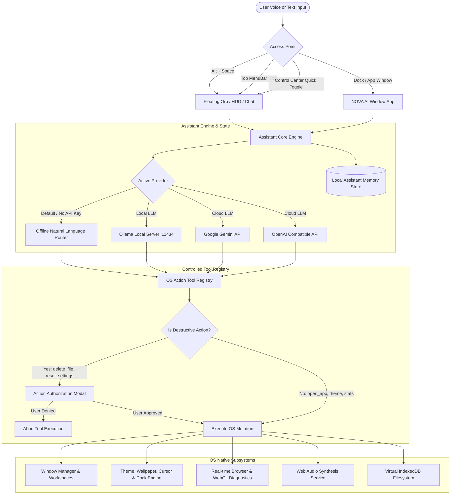

# NOVA AI - Intelligent Desktop Assistant Architecture & Reference

NOVA AI is the native, intelligent desktop assistant and automation engine designed exclusively for **NOVA OS**. It unifies conversational intelligence with a strictly controlled, typed operating system tool registry to bridge voice/chat interactions directly with desktop window management, visual theming, workspace isolation, audio synthesis, and real-time hardware telemetry.

---

## 1. High-Level Architecture

---

## 2. Interaction Modes

NOVA AI supports multiple presentation states adapting to user workflow preferences:

1. **Floating Interactive Orb**:
   - A draggable, physics-enabled glowing liquid-glass orb residing non-intrusively in the bottom-right corner of the desktop.
   - Pulses subtly with cosmic gradients during voice listening or background tool execution.
   - Click or tap to expand into the Chat Popup.

2. **Liquid Glass Chat Popup**:
   - Translucent popover attached to the orb with live message history, typed command input, voice toggle, tool execution progress stepper, and direct suggestions.

3. **Full Desktop Window (`src/apps/NovaAI/NovaAIApp.tsx`)**:
   - Standard OS window running on the window manager.
   - Includes full conversation history, AI Provider configuration (Offline, Ollama, Gemini, OpenAI), Local Semantic Memory manager, and live Tool Registry explorer.

4. **Mini Soundwave HUD**:
   - Displays real-time Web Audio frequency oscillations during speech input and text-to-speech output.

---

## 3. Global Shortcuts & Entry Points

| Entry Point | Trigger | Description |
|---|---|---|
| **Keyboard Shortcut** | `Alt + Space` | Toggles the floating assistant chat from anywhere in the OS without losing window focus. |
| **Top Menu Bar** | Sparkles icon | Located in the system status tray; opens the floating assistant popup immediately. |
| **Dock** | NOVA AI Icon | Launches the dedicated, full-featured NOVA AI window application. |
| **Control Center** | "NOVA AI" Quick Toggle | One-click access from the liquid-glass Control Center panel. |

---

## 4. Controlled Tool Registry

To guarantee safety, stability, and predictable behavior, the assistant cannot execute arbitrary code or shell injection. Every OS mutation must pass through the **17 Typed Tool Definitions** registered in `src/core/assistant/tools/toolRegistry.ts`:

| Tool Name | Parameters | Destructive? | User Confirmation | Description |
|---|---|---|---|---|
| `open_app` | `appId: string`, `args?: object` | No | Automatic | Launches or brings an application window into focus. |
| `close_app` | `windowIdOrAppId: string` | No | Automatic | Closes an active virtual window or process. |
| `minimize_app` | `windowIdOrAppId: string` | No | Automatic | Minimizes a window to the dock. |
| `restore_app` | `windowIdOrAppId: string` | No | Automatic | Restores a minimized window. |
| `focus_window` | `windowId: string` | No | Automatic | Brings a specific window to the top z-index. |
| `list_apps` | `filter?: 'all' \| 'running'` | No | Automatic | Returns all registered or currently open applications. |
| `change_wallpaper` | `wallpaperId: string` | No | Automatic | Updates desktop wallpaper with fallback solid color protection. |
| `change_theme` | `themeId: string` | No | Automatic | Switches OS theme (Liquid Glass, Cyberpunk, Obsidian, Light, etc.). |
| `change_accent` | `accentColor: string` | No | Automatic | Updates the active UI accent color across all windows and controls. |
| `set_dock_position` | `position: 'bottom' \| 'left' \| 'right'` | No | Automatic | Moves the application dock to bottom, left (Ubuntu), or right. |
| `switch_workspace` | `workspaceId: number` | No | Automatic | Switches the active virtual desktop workspace (1 to 4). |
| `get_system_stats` | *(none)* | No | Automatic | Samples real browser FPS, JS heap memory, storage quota, and active windows. |
| `launch_game` | `gameNameOrId: string` | No | Automatic | Launches any 2D or 3D game (e.g. Blockworld 3D, Space Tunnel, Chess). |
| `lock_system` | *(none)* | No | Automatic | Immediately locks NOVA OS and presents the cryptographic lock screen. |
| `set_volume` | `volume: number (0-100)` | No | Automatic | Adjusts Web Audio master volume. |
| `toggle_sounds` | `enabled: boolean` | No | Automatic | Mutes or enables system sound effects. |
| `delete_file` | `fileIdOrPath: string` | **Yes** | **Requires Authorization** | Moves a file in the virtual filesystem to Trash. |
| `reset_settings` | *(none)* | **Yes** | **Requires Authorization** | Resets desktop personalization settings to factory defaults. |

### Safety & Confirmation Modal Contract
When a destructive tool (`isDestructive: true`) is requested, NOVA AI pauses execution and triggers an inline **Action Authorization Card**:
- Explains the exact action and target.
- Requires explicit user interaction ("Authorize" or "Cancel").
- Cancels immediately if dismissed or unconfirmed.

---

## 5. Multi-Provider Intelligence Architecture

### 1. 100% Offline Command Router (Default)
- Operates entirely locally with **zero network latency** and **zero external API calls**.
- Leverages high-performance regex pattern matching and semantic token normalization.
- Instantly handles desktop navigation, window management, theme switching, game launching, and system queries.

### 2. Local Ollama Integration
- Connects directly to local Ollama instances running on `http://localhost:11434`.
- Supports models like `llama3:latest`, `mistral`, `phi3`, etc.
- 100% private; all prompt data remains on user's local machine.

### 3. Google Gemini API
- Connects via official Gemini endpoints using model `gemini-2.0-flash`.
- Supports natural streaming responses, structured reasoning, and desktop tool calling.

### 4. OpenAI & Compatible Endpoints
- Supports `gpt-4o-mini`, `gpt-4o`, or any local OpenAI-compatible endpoint (e.g. LocalAI, vLLM, LM Studio).

---

## 6. Voice Input & Speech Synthesis

- **Speech Recognition**: Uses the browser's native `webkitSpeechRecognition` or `SpeechRecognition` API. Supports continuous listening mode and automatic intent parsing upon speech pause.
- **Speech Synthesis**: Uses `window.speechSynthesis` with selectable system voices, customizable pitch, and speech rate controls.
- **Graceful Fallback**: If browser speech APIs are unsupported or permission is denied, voice buttons disable gracefully and display user-friendly status indicators without crashing.

---

## 7. Local Semantic Memory

NOVA AI features persistent memory stored in `localStorage` under `nova_ai_memory_v2`:
- Stores user preferences (e.g., preferred theme, favorite games, typical workspace layout).
- Can be viewed, edited, added to, or deleted at any time via the **Memory** tab in the NOVA AI application.
- Fully private and isolated to the local browser profile.
